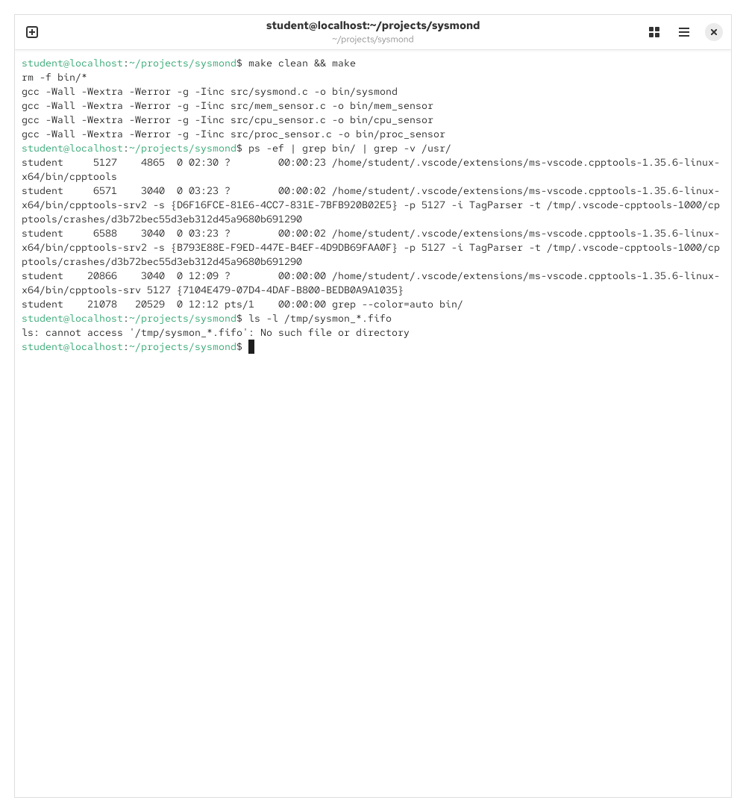
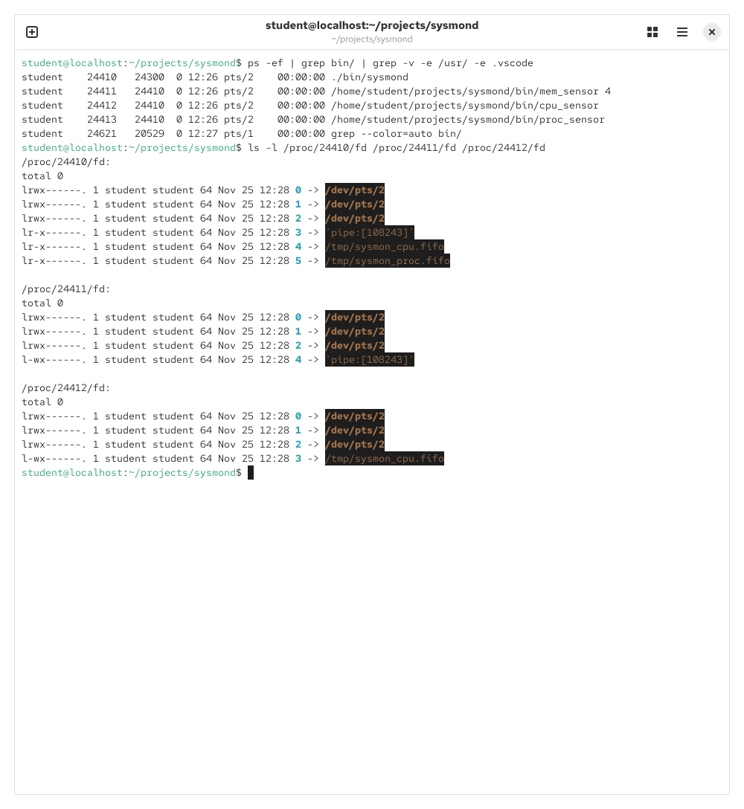
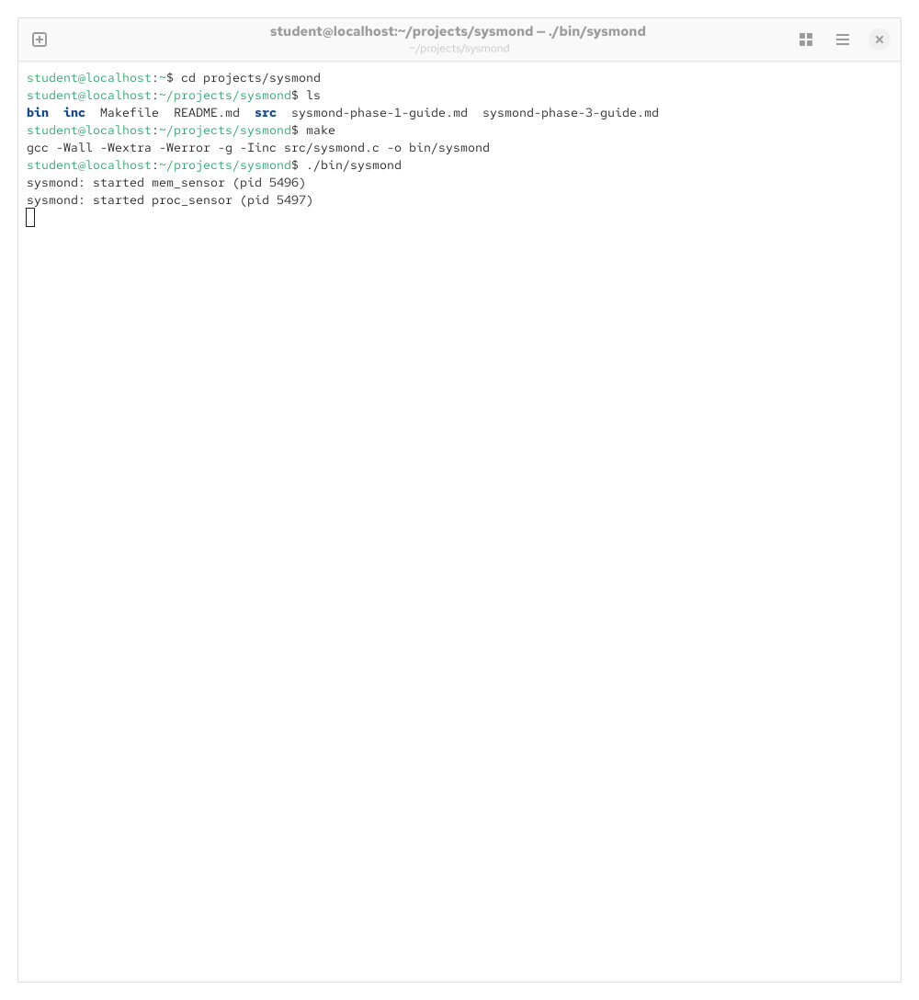
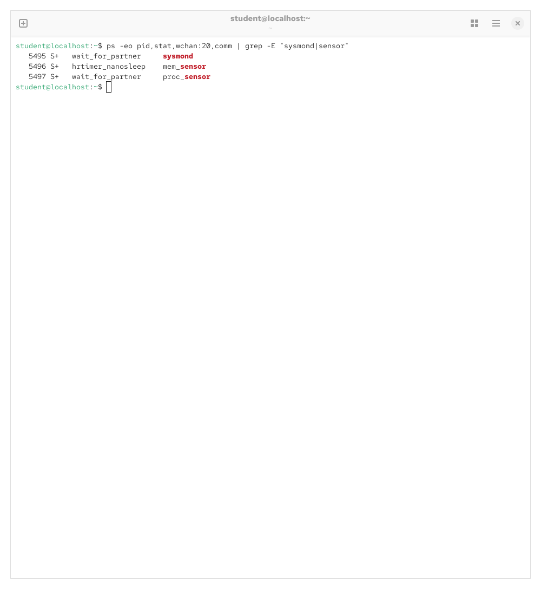
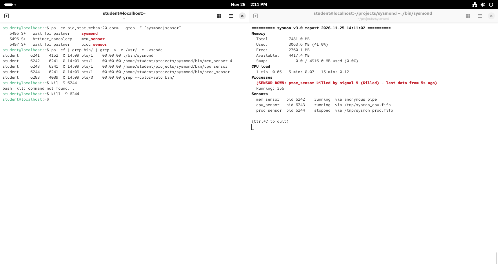
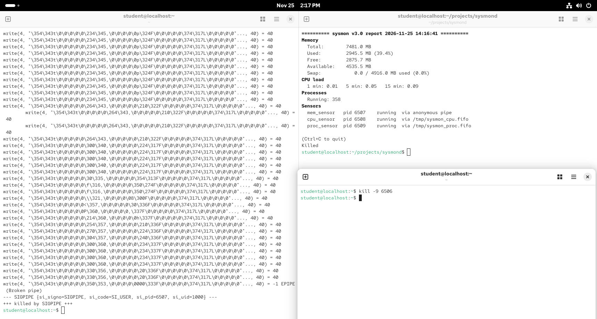
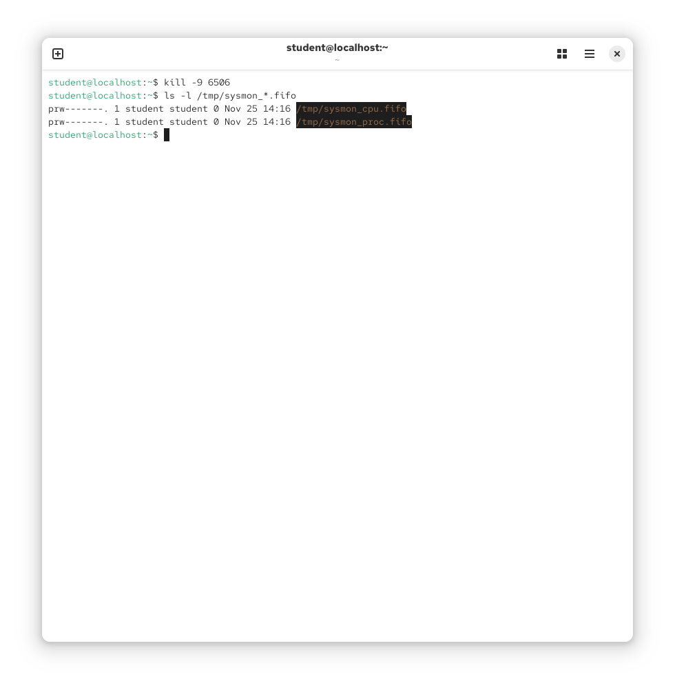
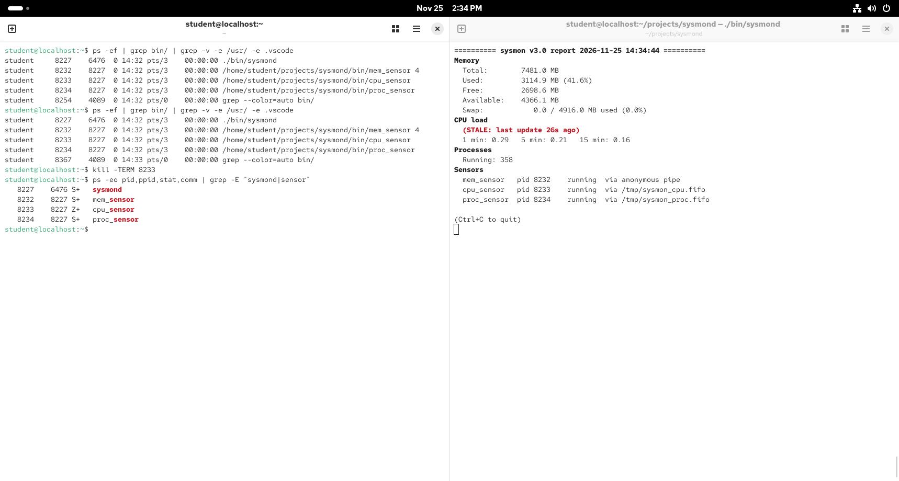
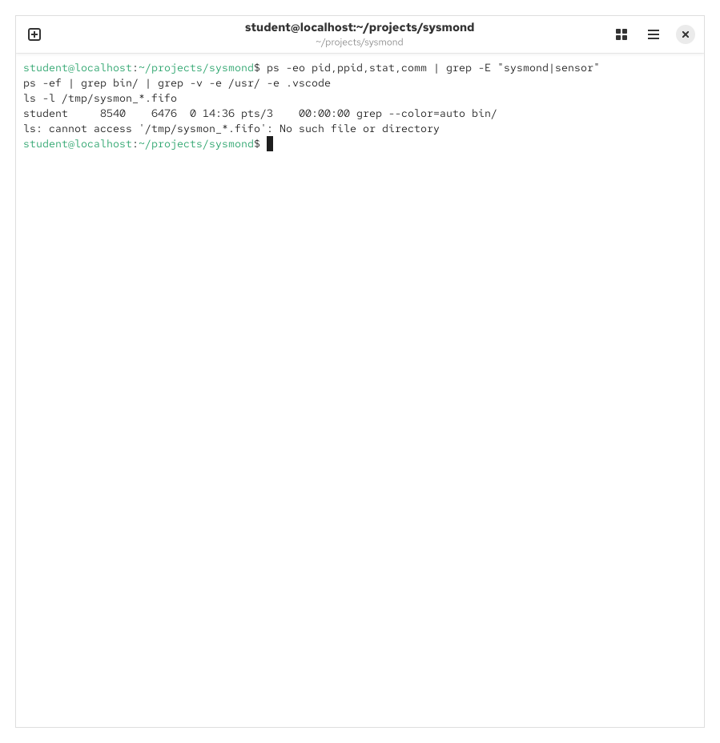

# sysmond Phase 3 – Lab Report

Branch: `phase3` (v3.0)
System: Oracle Linux Server 10.2, kernel 6.12, gcc 14.3.1

Terminal A runs `./bin/sysmond`. Terminal B is used for inspection, and in Experiment 3B a third terminal sends the kill.
To keep the `ps` output short, the guide's `ps -ef | grep bin/` is filtered with `grep -v -e /usr/ -e .vscode`. This removes unrelated programs that also run from a `bin/` directory: system programs in `/usr/bin` and the VS Code C/C++ extension.

---

## Prerequisites

`make clean && make` with `CFLAGS = -Wall -Wextra -Werror -g -Iinc` builds all four programs with no warnings.
Before the experiments, no `sysmond` or sensor processes were running and there were no `/tmp/sysmon_*.fifo` files.
The `cpptools` processes in the screenshot belong to VS Code, not to sysmond.

---

## Experiment 1: Inherited file descriptors and the pipe inode

PIDs: `sysmond` 24410, `mem_sensor` 24411, `cpu_sensor` 24412.

**Question 1A**
`mem_sensor` received fd **4** (`argv[1] = "4"`, visible in `ps` as `mem_sensor 4`).
In `/proc`, `sysmond` has `3 -> pipe:[108243]` (read end) and `mem_sensor` has `4 -> pipe:[108243]` (write end).
Both fds point to the same inode, 108243, so they refer to the same pipe buffer in the kernel. The fd numbers are different only because every process has its own fd table. `mem_sensor` got fd 4 because `fork()` copied `sysmond`'s fd table and `execve()` kept it open.

**Question 1B**
`cpu_sensor` has only fds 0, 1, 2 and `3 -> /tmp/sysmon_cpu.fifo`, and no `pipe:[...]` entry.
A reader gets EOF (`read()` returns 0) only when every write end of the pipe is closed. If `cpu_sensor` also held `pipefd[1]`, killing `mem_sensor` would leave one writer open, so `sysmond` would never get EOF. With a blocking read it would hang forever. With `poll()` it would never see `POLLHUP`, so the memory channel would stay open with stale data and the dead sensor would not be detected through the pipe.

---

## Experiment 2: FIFO rendezvous blocking and WCHAN

Temporary changes in `src/sysmond.c`, reverted afterwards with `git restore`:
- line 417: commented out `spawn(&sensors[CPU], ...)`, so `cpu_sensor` is never started.
- line 423: removed `O_NONBLOCK` from the CPU FIFO `open()`. Without this change our `sysmond` does not stall at all, because a non-blocking open of a FIFO returns immediately even when no writer exists.

PIDs: `sysmond` 5495, `mem_sensor` 5496, `proc_sensor` 5497.

**Question 2A**
`sysmond` is in state `S` with WCHAN **`wait_for_partner`**, the kernel function that `fifo_open()` uses to wait for the other side of a FIFO.
The blocking call is line 423:
`sensors[CPU].fd = open(CPU_FIFO_PATH, O_RDONLY | O_CLOEXEC);`
A blocking `open()` of a FIFO for reading waits until a writer opens it. The writer is `cpu_sensor`, which was never started.

**Question 2B**
`mem_sensor` is in `S` with WCHAN `hrtimer_nanosleep`. It is only sleeping in its `sleep(1)` and keeps writing every second. Its anonymous pipe was created by `pipe()` and inherited already open, so it never has to wait for an `open()`.
`proc_sensor` is also in `S`, but its WCHAN is `wait_for_partner`. It is blocked in its own `open(PROC_FIFO_PATH, O_WRONLY)`, waiting for a reader. `sysmond` is stuck on line 423, so it never reaches line 424 where it opens the PROC FIFO.

**Question 2C**
65,536 bytes / 40 bytes per `MemData` = 1,638.4, so 1,638 whole writes fit.
At one write per second that is about **1,638 seconds (about 27 minutes)**. The next write does not fit and `mem_sensor` blocks in `pipe_write`.

---

## Experiment 3: Mid-stream failure (EOF vs EPIPE / SIGPIPE)

### Part A: writer crash

`kill -9 6244` (`proc_sensor`). `sysmond` keeps running and shows `SENSOR DOWN: proc_sensor killed by signal 9 (Killed)`. Memory and CPU keep updating.

### Part B: supervisor crash

`strace -p 6507 -e trace=write,signal` on `mem_sensor`, then `kill -9 6506` (`sysmond`).

`cpu_sensor` and `proc_sensor` also exited by SIGPIPE on their next write, so no sensors were left. The FIFOs were removed by hand with `rm -f /tmp/sysmon_*.fifo`.

**Question 3**
- **Part A:** `read()` on `PROC_FIFO_PATH` returned **0 (EOF)**. `proc_sensor` was the only writer. When it was killed the kernel closed its fds, so no writer was left. `sysmond` closed the channel, so `poll()` stops reporting it, and `waitpid()` reported "killed by signal 9".
- **Part B:** `sysmond` held the only read end of the pipe. After it died nobody could read, so on its next write `mem_sensor` got `write() = -1 EPIPE (Broken pipe)` and the kernel sent it `SIGPIPE`. The default action of SIGPIPE terminates the process (`+++ killed by SIGPIPE +++`).
- **FIFOs vs anonymous pipe:** a FIFO is a file in the filesystem created with `mkfifo()`, and it stays until `unlink()` is called. `sysmond` calls `unlink()` in its cleanup, but SIGKILL cannot be caught, so the cleanup never ran and the files stayed (`prw-------`, size 0). The anonymous pipe has no name. It exists only while some fd refers to it, so it disappeared when the last process holding it exited.

---

## Experiment 4: Zombie process

Temporary change in `src/sysmond.c`, reverted afterwards with `git restore`:
line 469, `reap_sensors();` was changed to `if (0) reap_sensors();`. Normally `sysmond` calls `waitpid(WNOHANG)` on every loop, so a dead sensor is reaped within milliseconds and the zombie cannot be seen. Commenting the line out was not possible, because then `reap_sensors()` is never used and `-Werror` stops the build with `-Wunused-function`.

PIDs: `sysmond` 8227, `cpu_sensor` 8233.

`kill -TERM 8233`, then `ps` shows `8233 8227 Z+ cpu_sensor`: a zombie whose parent is still `sysmond`.
The report shows that without `waitpid()` the parent does not know the child is dead: CPU load is marked `STALE`, but the sensor table still says `cpu_sensor ... running`.

After Ctrl+C in Terminal A, no processes, zombies or FIFO files are left:

**Question 4**
When a process ends, the kernel frees its memory and closes its fds, but it keeps a small entry in the process table with the PID and the exit status. The entry is kept so the parent can find out how the child ended. It stays as a zombie until the parent collects that status.
On Ctrl+C, `stop_sensors()` sends SIGTERM to every sensor it still thinks is alive (this does nothing to a zombie), then calls a blocking `waitpid(pid, &status, 0)` for each one. `waitpid()` returns the zombie's exit status and the kernel removes the entry and frees the PID. That is why `ps` shows nothing after shutdown.
