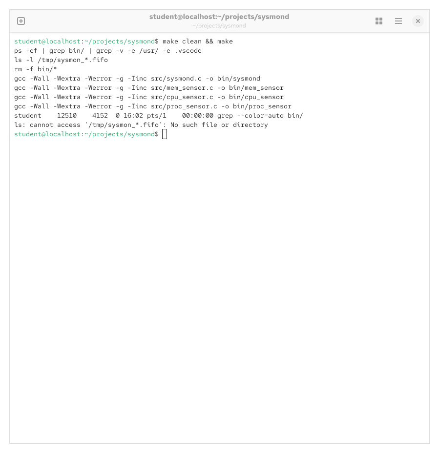
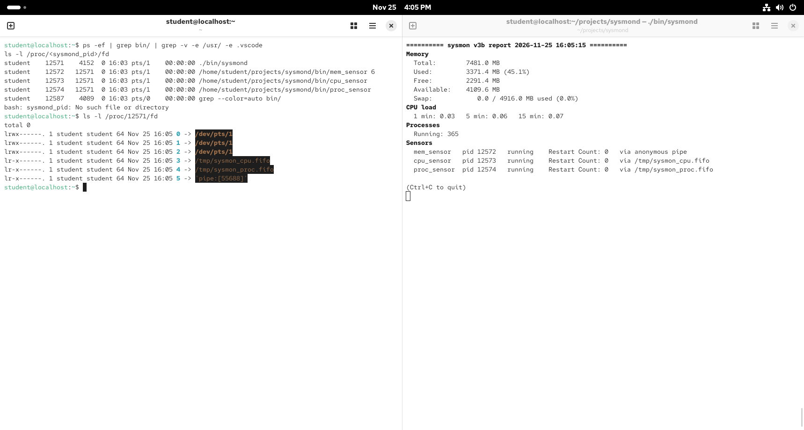
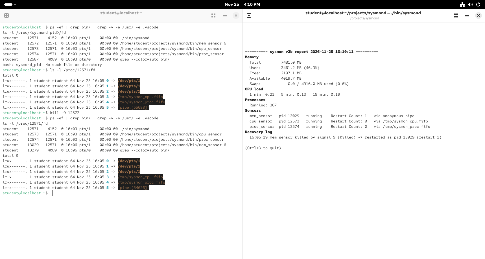
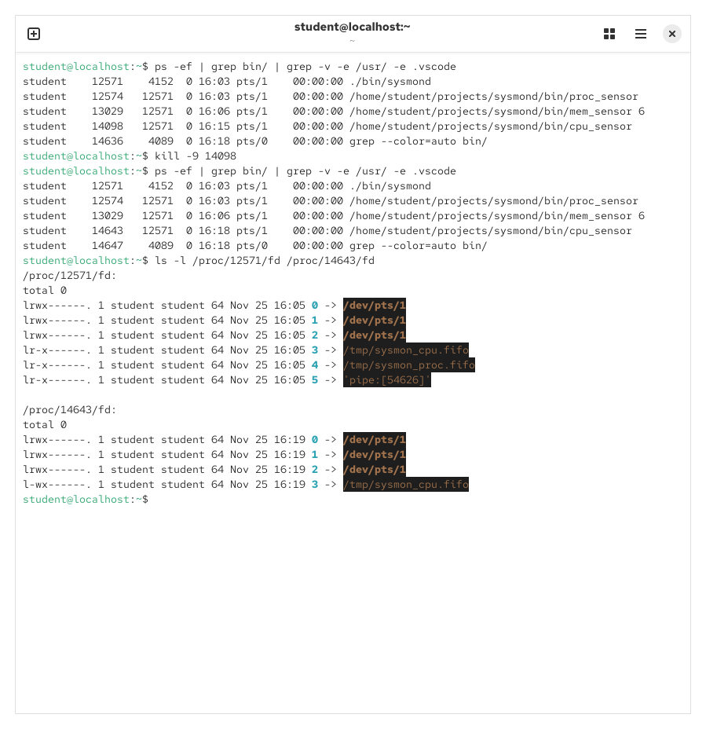
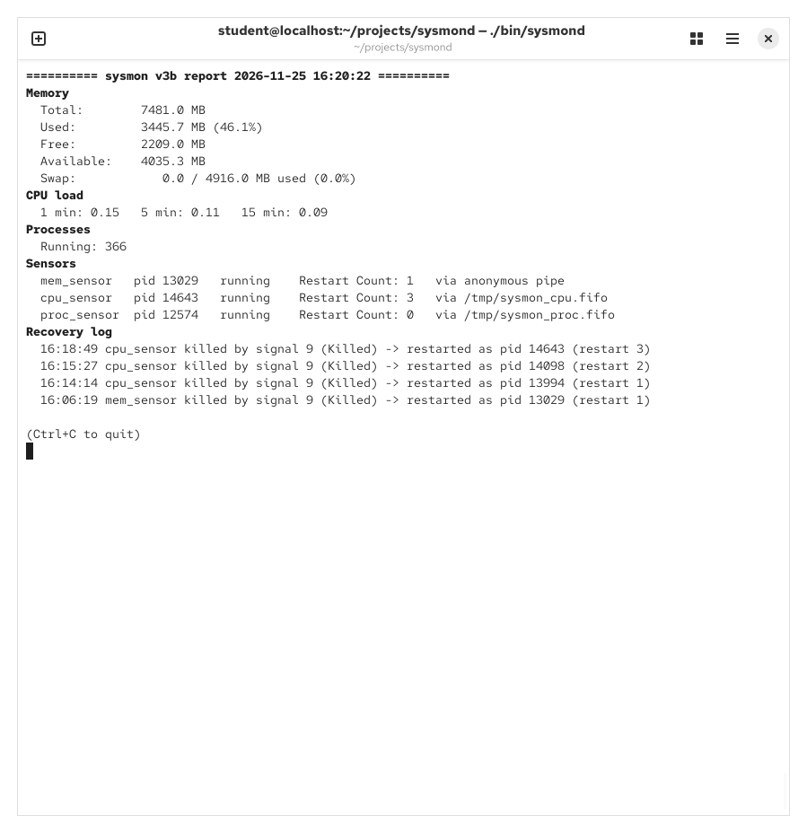
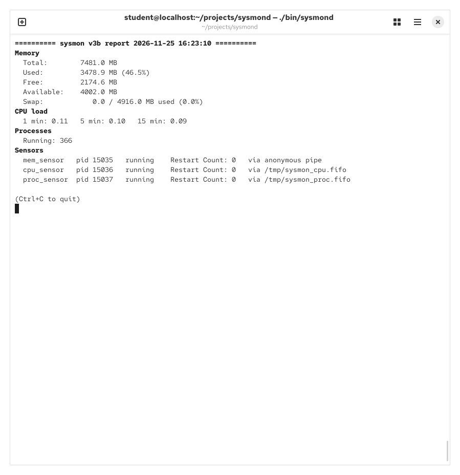
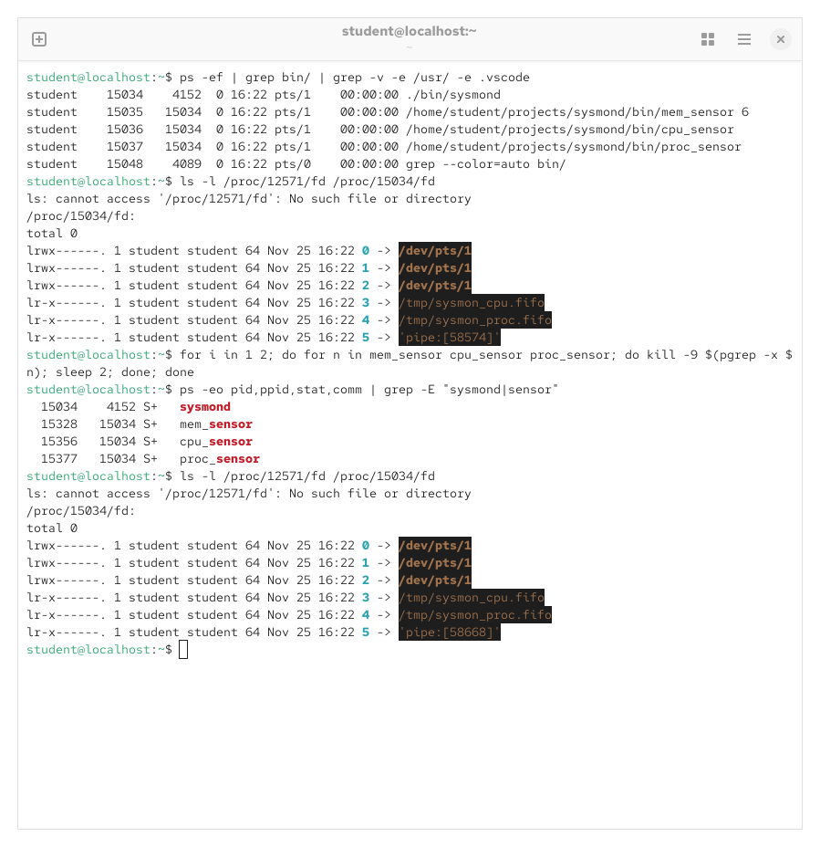
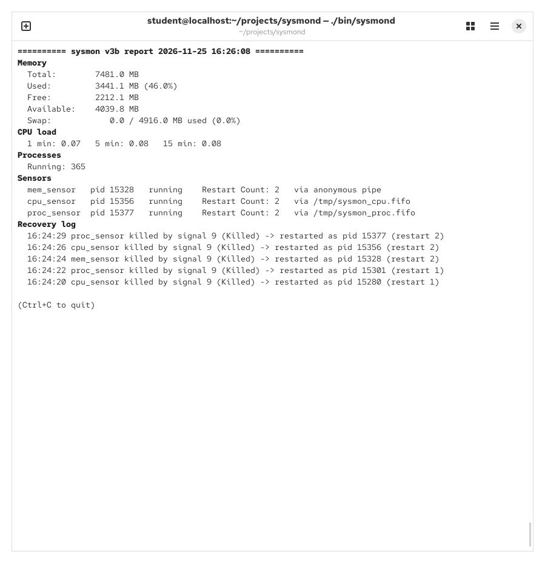
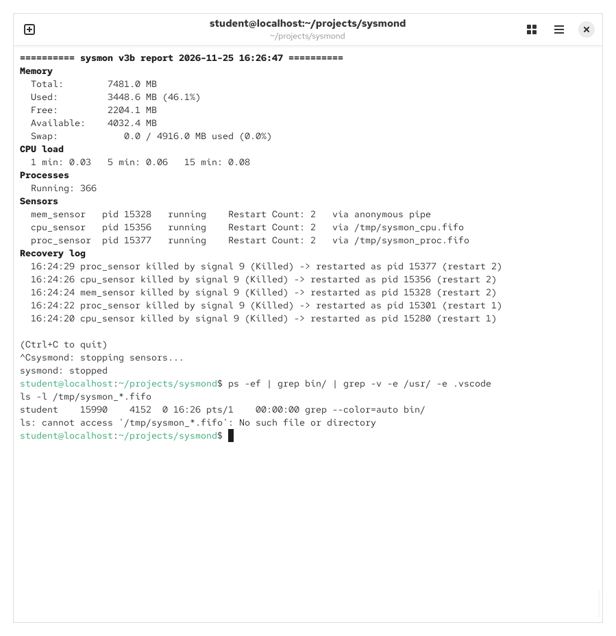

# sysmond Phase 3B – Watchdog Lab Report

Branch: `phase3b` (v3b)
System: Oracle Linux Server 10.2, kernel 6.12, gcc 14.3.1

Terminal A runs `./bin/sysmond`. Terminal B is used for inspection.
To keep the `ps` output short, the guide's `ps -ef | grep bin/` is filtered with `grep -v -e /usr/ -e .vscode`. This removes unrelated programs that also run from a `bin/` directory.

---

## Watchdog design (Part 1)

All changes are in `src/sysmond.c`. The sensors are unchanged, and in `inc/sysmon_ipc.h` only the version string changed (`"3b"`).

- **Per-sensor state:** `struct sensor` keeps the child PID, the read fd of its channel, whether a writer is connected, the last exit status and a restart counter.
- **Crash detection:** when a sensor dies, the kernel closes its write end and `read()` on the channel returns 0 (EOF). `sysmond` then reaps the child right away with `waitpid()` and checks `WIFSIGNALED` / `WIFEXITED`. The dashboard shows `Restart Count` for each sensor and a recovery log, e.g. `mem_sensor killed by signal 9 (Killed) -> restarted as pid 13029 (restart 1)`.
- **mem_sensor (anonymous pipe):** the old read fd is closed, a new `pipe()` is created, and the new write end is passed to the new `mem_sensor` in `argv[1]`. `sysmond` closes its copy of the write end right after the fork. Every fd `sysmond` reads from is close-on-exec (`O_CLOEXEC` / `FD_CLOEXEC`), so a sensor only holds its own channel.
- **cpu_sensor / proc_sensor (FIFOs):** the FIFO read ends are opened once at startup and stay open. Only the sensor is restarted. It opens the same FIFO for writing, and `sysmond` keeps reading on the same fd. While a FIFO has no writer, it is left out of `poll()` (it would report `POLLHUP` on every call) and checked every 50 ms instead, so the other sensors are never blocked and the loop doesn't spin.
- **Extra safety:** a sensor is restarted at most once per second, so a sensor that fails right away can't restart in a tight loop. The loop also calls `waitpid(-1, WNOHANG)` to catch a child that died without producing EOF.
- **Clean shutdown:** on SIGINT / SIGTERM the main loop ends and the cleanup sends SIGTERM to each sensor, reaps it with `waitpid()`, closes all fds and unlinks both FIFOs. Nothing is restarted during shutdown.

`poll()` and `fcntl()` are used as in our Phase 3 code. `poll()` is what lets `sysmond` wait on three channels at once without one blocking the others.

---

## Prerequisites

`make clean && make` with `-Wall -Wextra -Werror` builds all four programs with no warnings. Before the experiments, no sensor processes were running and there were no `/tmp/sysmon_*.fifo` files.



---

## Experiment 1: Anonymous pipe inode replacement

PIDs: `sysmond` 12571, `mem_sensor` 12572.

Before: `sysmond` has `3 -> /tmp/sysmon_cpu.fifo`, `4 -> /tmp/sysmon_proc.fifo` and `5 -> pipe:[55688]`. `mem_sensor` was started as `mem_sensor 6` (the write end).



After `kill -9 12572`, `sysmond` restarted it as PID 13029 (still `mem_sensor 6`). `sysmond`'s fd 5 now points to `pipe:[54626]`, and the dashboard shows `Restart Count: 1` with the recovery message.



**Question 1A**
The inode changed from `pipe:[55688]` to `pipe:[54626]`, so it is a new pipe. The fd number (5) is the same only because it was the lowest free number again.
The old pipe could not be reused. Its only writer was the dead `mem_sensor` (`sysmond` had closed its own copy of the write end), so the pipe had no writers left and `read()` on it can only return EOF. An anonymous pipe also has no name, so a new process cannot `open()` it. The only way to give the new `mem_sensor` a channel is to create a new pipe and pass it through `fork()` / `execve()`.

**Question 1B**
Before and after the recovery, `sysmond` has `3 -> /tmp/sysmon_cpu.fifo` and `4 -> /tmp/sysmon_proc.fifo`. Only fd 5 (the pipe) changed. `cpu_sensor` and `proc_sensor` kept their original PIDs and `Restart Count: 0`.

---

## Experiment 2: Named FIFO writer re-attachment

Same `sysmond` (12571). `cpu_sensor` was killed three times with `kill -9`; the last one was PID 14098, restarted as 14643.



`sysmond` still has `3 -> /tmp/sysmon_cpu.fifo` (read-only), the same fd as before the crashes. The new `cpu_sensor` (14643) has only fds 0–2 and `3 -> /tmp/sysmon_cpu.fifo` (write-only), which it opened itself.



**Question 2A**
EOF on a pipe or FIFO means that no process has it open for writing. It does not depend on whether the FIFO file exists in `/tmp`; the file is only a name used to find the pipe. When `cpu_sensor` died, the kernel closed its write end. It was the only writer, so the next `read()` in `sysmond` returned 0.

**Question 2B**
Opening a FIFO with `O_WRONLY` only waits until a reader exists. `sysmond` keeps its read end open for the whole run, including while the sensor is down, so the new `cpu_sensor`'s `open()` returns immediately.

---

## Experiment 3: Cascading crash stress test and leak audit

New run: `sysmond` 15034, started with all restart counts at 0.



Terminal B: `sysmond`'s fds before, then 6 crashes (each sensor killed twice, 2 seconds apart), then `ps` and `sysmond`'s fds after:
```bash
for i in 1 2; do for n in mem_sensor cpu_sensor proc_sensor; do kill -9 $(pgrep -x $n); sleep 2; done; done
```



The `ls: cannot access '/proc/12571/fd'` line is from reusing the previous command from the shell history, which included the old `sysmond` PID from Experiments 1–2. The listing for 15034 below it is the relevant one.

- **No zombies:** `ps` shows `sysmond` and the three new sensors (15328, 15356, 15377), all in state `S`, with PPID 15034. There are no `Z` entries.
- **Constant fd count:** `sysmond` has 6 fds before and after (0–2, the two FIFOs at 3 and 4, and the pipe at 5). Only the pipe inode changed (`58574` -> `58668`), because `mem_sensor` got a new pipe each time.



All three sensors show `Restart Count: 2`. The recovery log keeps the last 5 events, so the first `mem_sensor` crash is no longer shown.

After Ctrl+C, `sysmond` stopped its sensors and exited. No processes and no FIFO files are left:


